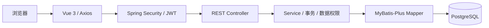

# 企业智能工单与知识协同平台

**完整版入口：** [运行与运维指南](docs/ENTERPRISE_GUIDE.md)。新增 Redis、事务消息、运维监控、账号管理、真实 Ollama/pgvector 问答及容器部署。原有轻量 dev 模式继续可用。

**分布式模式：** [微服务与集群指南](docs/DISTRIBUTED_GUIDE.md)。新增独立知识服务与数据库、Spring Cloud Gateway / Eureka、Redis 3 主 3 从、RabbitMQ 3 节点 Quorum，以及 Kubernetes 多副本部署和故障验证脚本；原单体模式和数据卷保留。实际验收范围以对应报告为准。

Smart Ticket System 是企业内部 IT 支持场景的前后端分离项目。在已有 Spring Boot 后端上增量完善，使用 PostgreSQL 保存用户、工单、沟通记录、处理历史和知识文章。普通用户提交和跟进自己的工单，管理员管理全局工单并维护知识库。

**工单详情的知识推荐仍采用关键词匹配。** `enterprise,ai` 模式另行提供 Ollama + Embedding + pgvector 检索问答，带真实知识出处；两者界面和原理明确区分。`dev` 模式只依赖 PostgreSQL。旧版扩展文档保留作历史参考，当前配置与运行方式以 [完整版指南](docs/ENTERPRISE_GUIDE.md) 为准。

## 技术栈

| 层 | 技术 |
|---|---|
| 后端 | Java 21、Spring Boot 4.1.1、Spring MVC、Spring Security、JWT 0.13、MyBatis-Plus 3.5.17、Jakarta Validation、BCrypt |
| 数据库 | PostgreSQL（当前机器已验证 PostgreSQL 18） |
| 中间件与 AI | Redis 7、RabbitMQ 4、事务 Outbox / Inbox、Ollama、pgvector、Spring AI |
| 前端 | Vue 3、Vite、JavaScript、Vue Router、Pinia、Axios、Element Plus |
| 工程与运维 | Maven Wrapper、JUnit、Playwright、Docker Compose、Nginx、Actuator、Prometheus、Grafana、GitHub Actions |
| 分布式扩展 | Spring Cloud 2025.1.3、Gateway、Eureka、LoadBalancer、Redis Cluster、Quorum Queue、Kubernetes |

保留原后端与既有业务，在其基础上添加可独立部署的知识服务、网关与注册中心模块；单体启动不要求启用分布式组件。

## 功能

- 已有功能保留：注册、登录、BCrypt 密码、JWT、Spring Security、USER / ADMIN、工单 CRUD、分页、状态筛选、关键词搜索、用户数据隔离、操作审计。
- 新增：中文 Vue 工作台、持久化登录状态、Dashboard 和状态分布图、优先级和用户名筛选、工单编辑和删除界面、评论时间线、自动处理历史、知识文章 CRUD 与发布、文章查询和分类、关键词知识推荐。
- 本轮完善：管理员指派处理人、取消指派、处理人筛选、分配给我的工单队列、指派历史；创建接口支持 `X-Request-Id`，相同请求重试不会重复创建工单或创建历史。
- 完整版：真实 Redis 缓存及原子限流、持久化 JWT 撤销、事务消息与消费去重、死信恢复、运行监控与审计、账号启停及改密、带出处的本地 AI 知识问答。
- 交付：独立容器部署、正式管理员引导、监控认证、备份与隔离恢复演练、源码及可执行成品包。验收证据与具体边界见 [最终交付报告](docs/FINAL_DELIVERY.md)。
- 查询优化：工单列表、评论与历史按批次查询用户名；Dashboard 使用一条聚合 SQL；推荐先读取匹配元数据，再加载最多三篇文章正文。Element Plus 按需加载组件与样式。
- 修复：普通工单 PUT 接口无法绕过状态权限；创建时由服务器确定所属用户、OPEN 状态和时间；更新时间实际刷新；并发状态修改采用条件更新，避免错误历史；密码哈希不返回给前端。
- 统一错误结构：参数错误 400、未登录/Token 无效 401、权限不足 403、资源不存在 404、冲突 409、登录限流 429、数据库不可用 503。

## 架构与目录



```text
smart-ticket-system/
├── PROJECT_TASK.md                    开发要求
├── pom.xml                            根 Maven 聚合入口，保留 backend 目录
├── backend/
│   ├── pom.xml / mvnw.cmd / mvnw
│   ├── config/application-local.properties.example
│   └── src/
│       ├── main/java/com/smartticket/backend/
│       │   ├── config/                 Security、时间填充、dev 初始化
│       │   ├── controller/             User、Ticket、Activity、Knowledge
│       │   ├── dto/                    请求校验与统一响应
│       │   ├── entity/                 User、Ticket、Comment、History、Article
│       │   ├── mapper/                 MyBatis-Plus 数据访问
│       │   ├── service/                业务、权限、推荐、JWT、黑名单
│       │   ├── security/               JWT 过滤器与 AuthUser
│       │   └── exception/              全局异常处理
│       ├── main/resources/             application*.properties、schema.sql
│       └── test/java/                  启动测试、PostgreSQL 业务回归测试
├── frontend/
│   ├── package.json / package-lock.json / vite.config.js
│   └── src/
│       ├── api.js / router.js / stores/auth.js
│       ├── Layout.vue / style.css / utils.js
│       └── views/                      登录、概览、工单、知识列表/详情/编辑
├── sql/schema.sql                     安全增量数据库结构
├── scripts/                           启动、npm 辅助、HTTP、浏览器验证
├── docs/                              验收报告、请求结果、页面截图
└── compose.yaml / docker/              保留旧版扩展基础设施配置
```

实际后端仍位于 `backend/`，原代码路径和 Maven Wrapper 不变；根目录 `mvn test` / `mvn clean package` 会构建后端模块。

## 数据库结构与初始化

| 表 | 作用与关系 |
|---|---|
| `app_user` | 用户、BCrypt 密码哈希、USER / ADMIN 角色 |
| `ticket` | 工单；创建人 `user_id` 和处理人 `assignee_id` → `app_user.id`；创建与更新时间 |
| `ticket_comment` | 沟通记录；工单与用户外键，删除工单时级联删除 |
| `ticket_history` | CREATE / CHANGE_STATUS / ASSIGN；记录前后状态、前后处理人和操作人 |
| `ticket_request` | `(user_id, request_id)` 唯一键、请求内容摘要及结果工单；保证带请求编号的创建幂等 |
| `knowledge_article` | 标题、摘要、正文、分类、关键词、DRAFT / PUBLISHED；作者外键 |
| `operation_log` | 保留原有审计表；目标 ID 是审计信息，删除工单后审计仍保留 |
| `token_blacklist` | 保存 SHA-256 Token 摘要与到期时间；Redis 缓存丢失和重启不会恢复已撤销会话 |
| `event_outbox` / `processed_message` | 业务事务中的待发事件、租约及重试记录，数据库消费去重 |
| `knowledge_vector_index` / `smartticket_article_vectors` | 已发布知识版本指纹、独立 768 维向量检索 |
| `demo_seed` | dev 数据初始化版本标记，防止重复插入 |
| `vector_store` | 旧版 pgvector 扩展表，核心演示不使用 |

`sql/schema.sql` 与后端资源中的 `schema.sql` 内容一致。`dev` 和 `prod` 模式执行幂等增量结构脚本，使用 `CREATE TABLE IF NOT EXISTS` / `ADD COLUMN IF NOT EXISTS`，不执行 DROP、不清空原数据。正式环境不加载演示数据；只有显式选择 `-Demo` 才同时启用 dev 数据初始化。

`DataInitializer` 仅在 `@Profile("dev")` 下运行，以 PostgreSQL 事务、事务级 advisory lock 和 `demo_seed` 标记保证幂等。新增 25 条企业 IT 工单，覆盖 1–5 优先级、不同用户与不同时间；新增 12 篇有完整正文的知识文章，部分工单附带留言和状态历史。初始化使用正式 Service 产生工单历史，业务创建和管理员操作也自动产生历史。

原数据库账号、角色、9 条工单均保留。已有 BCrypt 密码不重置；发现旧 testuser 的未编码密码字段后，将同一密码值升级为 BCrypt 存储。已有 `zhangsan`、`admin1` 等账号不会重置密码；为确保可登录演示，新建独立的 `dev_*` 账号。缺少的 `lisi`、`wangwu` 等基础账号也会补齐，但演示推荐使用下表账号。

## 权限与工单状态

| 能力 | USER | ADMIN |
|---|---|---|
| 工单查询、详情、修改、删除 | 仅本人 | 全部 |
| 工单留言、历史、推荐 | 仅本人工单 | 全部 |
| 修改状态 | 禁止 | 允许合法流转 |
| 指派处理人、处理人队列 | 禁止 | 指派给有效 ADMIN，保留原创建人 |
| 知识查询、详情 | 仅 PUBLISHED | PUBLISHED 与 DRAFT |
| 知识创建、修改、删除、发布 | 禁止 | 允许 |
| Dashboard | 本人工单 | 全局工单、用户数、知识数 |

主流程：`OPEN → IN_PROGRESS → CLOSED`。保留旧版 `RESOLVED`，兼容流程 `IN_PROGRESS → RESOLVED → CLOSED`，不允许跳过待处理直接关闭或关闭后逆向修改。普通 PUT 只编辑标题、描述、优先级，状态修改统一使用管理员 PATCH。

处理人限管理员账号，普通用户仍然只能查看自己的工单。已关闭或已解决工单不能重新指派；重复保存同一处理人不会产生重复历史。指派采用条件更新，发生并发冲突时返回 409。

创建请求可携带 `X-Request-Id`（1–100 位字母、数字或 `._:-`）。同一用户、同一编号、相同标题/描述/优先级返回原工单；内容不同返回 409。不同用户的编号互不影响。不传编号时保留原有创建行为。唯一键认领、创建工单与历史、写回结果在同一 PostgreSQL 事务中完成；删除结果工单后重放原编号返回 409。前端在同一页面、相同内容的失败重试中复用编号，内容变化后生成新编号。该机制防止网络重试重复写入，不合并用户主动提交的相似工单。

认证流程：登录时验证 BCrypt → 签发含 `username / userId / role / jti / exp` 的 JWT → Axios 添加 Bearer Token → 过滤器验证签名、过期时间和黑名单 → 服务端按当前身份与工单归属授权。每次签发使用唯一 jti，退出后的旧 Token 失效，立即重新登录不会复用被撤销的 Token。

Pinia 保存 `token / userId / username / role`；刷新从 localStorage 恢复。401 清理状态并跳转登录；403 显示后端信息。Vue 管理员路由守卫用于界面体验，服务端仍实施权限校验。

## 运行步骤

### 1. 准备 PostgreSQL、Java 和 Node

- Java 21；已有 Maven Wrapper 或本机 Maven。
- PostgreSQL 正常运行并已有数据库 `intelligent_ticket`。本次未删除或重建已有数据库。
- Node.js 22.12+（推荐安装包含 npm 的标准发行版）。Vite 7 也支持满足要求的 Node 20.19+。

使用能访问该数据库且有建表权限的账号。当前本机数据库地址为 `localhost:5432`。如使用已有 Compose，数据库映射端口是 `5433`，配置 URL 时不要混淆；核心 dev 演示无需 Docker。

### 2. 配置数据库连接

推荐在 PowerShell 设置环境变量（占位符换成自己的实际值）：

```powershell
$env:SPRING_DATASOURCE_URL='jdbc:postgresql://localhost:5432/intelligent_ticket'
$env:SPRING_DATASOURCE_USERNAME='postgres'
$env:DB_PASSWORD='你的数据库密码'
```

或者复制 `backend/config/application-local.properties.example` 为同目录的 `application-local.properties` 并填写。本机原有数据库密码已经移动到该忽略文件，工作区仍可直接启动。`DB_PASSWORD` 环境变量覆盖文件内本机密码。Spring Boot 不会自动读取根 `.env`，`.env` 仅供 Compose 使用。

dev 使用公开的开发专用 JWT 签名默认值；非 dev 模式必须设置自己的 `JWT_SECRET`（至少 32 字节的 Base64 密钥）。启动真实部署时也需要把数据源密码作为环境配置提供。

### 3. 启动后端

在根目录运行辅助脚本：

```powershell
.\scripts\start-backend.ps1
```

或使用实际 Maven 命令：

```powershell
cd backend
.\mvnw.cmd spring-boot:run '-Dspring-boot.run.profiles=dev'
# 已安装 Maven 时：mvn spring-boot:run '-Dspring-boot.run.profiles=dev'
```

后端地址：`http://localhost:8080`，Swagger：`http://localhost:8080/swagger-ui/index.html`。

从根目录运行构建出的 JAR 也可以：

```powershell
java -jar backend/target/backend-0.0.1-SNAPSHOT.jar --spring.profiles.active=dev
```

### 4. 启动前端

另开终端，从根目录执行：

```powershell
cd frontend
npm install
npm run dev
```

若本机仅有 Codex 自带 Node、没有全局 npm，根目录辅助脚本支持下载 npm 到系统临时目录后启动：

```powershell
.\scripts\start-frontend.ps1
# 等价安装和构建：
cd frontend
..\scripts\npm.ps1 install
..\scripts\npm.ps1 run build
```

打开 `http://127.0.0.1:5173`。Vite 将 `/api` 代理到 8080，浏览器使用同源请求；开发 CORS 只允许 localhost / 127.0.0.1:5173。部署静态 `dist/` 时，需要为 `/api` 配置反向代理并为 Vue 路由配置回退到 `index.html`，或在构建时设置 `VITE_API_BASE_URL` 并配置明确的 `CORS_ORIGINS`。

### 5. 开发测试账号

**仅限开发环境，密码均为 `Demo@12345`，数据库保存 BCrypt 哈希。**

| 用户名 | 角色 |
|---|---|
| `dev_zhangsan` | USER |
| `dev_lisi` | USER |
| `dev_wangwu` | USER |
| `dev_admin1` | ADMIN |

推荐演示：USER 登录 → 创建 VPN 工单 → 查看推荐与留言 → ADMIN 登录 → 开始处理 → 回复 → 关闭 → USER 刷新查看历史。

## API 清单

所有成功响应：`{ "code": 200, "message": "success", "data": ... }`。错误的 HTTP 状态码与 JSON `code` 一致；响应不泄露 Java 堆栈。

| Method | URL | 权限 | 作用 |
|---|---|---|---|
| POST | `/users/register` | 公开 | 注册普通用户 |
| POST | `/users/login` | 公开 | 验证账号密码并返回 JWT 与身份 |
| POST | `/users/logout` | 登录 | 撤销当前 Token |
| POST | `/users/change-password` | 登录 | 校验原密码、更新密码并撤销全部旧会话 |
| GET / POST | `/admin/users` | ADMIN | 用户分页、创建普通账号 |
| PATCH | `/admin/users/{id}` | ADMIN | 角色与启用状态，立即使旧会话失效 |
| GET | `/admin/system` | ADMIN | 服务状态、消息队列与 outbox 记录 |
| POST | `/admin/outbox/{id}/retry` | ADMIN | 重新投递达到重试上限的失败事件 |
| POST | `/admin/mq/replay-dead-letter` | ADMIN | 先持久化再确认的死信重放 |
| GET | `/system/capabilities` | 登录 | 当前真实启用的模块 |
| POST | `/ai/assist` | 登录、AI 启用 | 向量检索问答及已发布文章来源 |
| GET / POST | `/admin/ai/index` | ADMIN、AI 启用 | 索引状态与同步 |
| GET | `/users/{id}` | 本人 / ADMIN | 查询用户，不返回密码哈希 |
| GET | `/users/handlers` | ADMIN | 可指派管理员列表，仅返回 id / username |
| GET | `/tickets` | 登录 | 保留旧列表，按角色隔离 |
| GET | `/tickets/page` | 登录 | 分页、status、priority、keyword；ADMIN 支持 username、assigneeId、assignedToMe |
| GET | `/tickets/statistics` | 登录 | 当前范围统计；管理员附用户与知识数量 |
| POST | `/tickets` | 登录 | 创建本人工单，服务器指定 OPEN 和时间 |
| GET | `/tickets/{id}` | 本人 / ADMIN | 详情、创建用户名 |
| PUT | `/tickets/{id}` | 本人 / ADMIN | 编辑标题、描述、优先级 |
| DELETE | `/tickets/{id}` | 本人 / ADMIN | 删除工单，级联删除评论与历史 |
| PATCH | `/tickets/{id}/status` | ADMIN | 合法状态流转并自动记录历史 |
| PATCH | `/tickets/{id}/assignee` | ADMIN | `{ "assigneeId": ID }` 指派；null 取消，并记录历史 |
| GET / POST | `/tickets/{id}/comments` | 本人 / ADMIN | 查询 / 新增留言 |
| GET | `/tickets/{id}/history` | 本人 / ADMIN | 查询创建和状态历史 |
| GET | `/tickets/{id}/knowledge-recommendations` | 本人 / ADMIN | 最多 3 篇匹配的已发布文章 |
| GET | `/knowledge` | 登录 | 分页、title、category、keyword；USER 只看已发布 |
| GET | `/knowledge/categories` | 登录 | 当前可见文章分类 |
| GET | `/knowledge/{id}` | 登录 | 文章详情；USER 不可读取草稿 |
| POST | `/knowledge` | ADMIN | 新建文章或草稿 |
| PUT | `/knowledge/{id}` | ADMIN | 编辑与发布（status 设置为 PUBLISHED） |
| DELETE | `/knowledge/{id}` | ADMIN | 删除文章 |
| GET | `/operation-logs` | ADMIN | 保留审计分页接口 |

分页参数 `current=1`、`size=10`，每页 1–100。工单优先级必填 1–5、标题非空且不超过 200 字，描述不超过 1000 字；留言非空且不超过 2000 字。知识正文按纯文本展示，不渲染未经处理的 HTML。

创建工单示例：

```json
{"title":"VPN认证失败","description":"VPN无法连接公司网络","priority":4}
```

知识文章创建/更新字段：`title, summary, content, category, keywords, status`；status 为 `DRAFT` 或 `PUBLISHED`。旧版 `/ai/**` 和消息补偿接口代码保留，dev 不启用 AI 控制器；扩展环境需原有基础设施。

## 前端页面

| URL | 页面 | 权限 |
|---|---|---|
| `/login` | 登录 | 未登录；已登录跳转概览 |
| `/register` | 注册普通账号；prod 默认需管理员开通 | 未登录 |
| `/account` | 修改密码、撤销全部旧会话 | 登录 |
| `/assistant` | AI 知识问答或未启用说明 | 登录 |
| `/admin/system` | 服务、消息、重试与知识索引 | ADMIN |
| `/admin/users` | 创建账号、角色与启停管理 | ADMIN |
| `/admin/audit` | 真实操作审计分页 | ADMIN |
| `/dashboard` | 当前身份、真实统计、状态图、最近工单 | 登录 |
| `/tickets` | 工单分页筛选 | USER 本人 / ADMIN 全部 |
| `/tickets/create` | 创建工单 | 登录 |
| `/tickets/:id` | 详情、评论、历史、推荐；管理员状态按钮 | 本人 / ADMIN |
| `/tickets/:id/edit` | 工单编辑 | 本人 / ADMIN |
| `/knowledge` | 分类、标题和关键词查询 | 登录 |
| `/knowledge/:id` | 文章正文 | USER 已发布 / ADMIN 全部 |
| `/admin/tickets` | 全部工单、用户名筛选 | ADMIN |
| `/admin/assigned` | 分配给当前管理员的工单 | ADMIN |
| `/admin/knowledge` | 知识管理、编辑与删除 | ADMIN |
| `/admin/knowledge/create` | 新增草稿或发布文章 | ADMIN |
| `/admin/knowledge/:id/edit` | 编辑与发布 | ADMIN |

## 推荐实现

`ArticleService.score()` 将工单标题、描述转为小写，匹配文章的关键词、分类和标题。关键词按中英文逗号、分号和空白分隔；只计算长度至少 2 的匹配词，按得分排序并取最多 3 篇 PUBLISHED 文章，不足时不补虚假结果。无匹配时展示空状态。

当前没有分词模型、语义理解和向量检索，因此相近含义但不同用词可能匹配不到，泛化词也可能带来较宽的推荐。后续可以扩展向量数据库 + Embedding + RAG + LLM；本次不把关键词算法包装为 AI。

## 验证与构建

从项目根目录执行：

```powershell
mvn test
mvn clean package
# 无本机 Maven 时：.\backend\mvnw.cmd -f pom.xml clean package
cd frontend
npm install
npm run build
```

JUnit 集成测试真实连接配置的 PostgreSQL。普通业务测试事务回滚自己的用户/工单；并发和事务失败测试使用独立事务并清理自己的记录。当前共 32 个测试；完整验收命令为 `mvn clean package '-Dinfra.tests=true'`，开启真实 Redis/RabbitMQ 集成测试。普通 `mvn test` 跳过需要中间件的 6 个测试。覆盖数据隔离、指派、幂等、并发、JWT、账号失效、缓存、消息确认、消费回滚、死信恢复与 AI 来源安全。dev 初始化保持幂等，不清空已有业务数据。

后端启动后可重复运行真实 HTTP 验证：

```powershell
python scripts/api_smoke.py
python scripts/db_verify.py
```

可选的浏览器验证，需要 Playwright 与 Chromium。可在单独工具目录安装，避免改变前端 lockfile，然后设置 `PLAYWRIGHT_MODULE` 指向 Playwright 目录：

```powershell
$env:PLAYWRIGHT_MODULE='你的工具目录/node_modules/playwright'
node scripts/ui_smoke.cjs
```

HTTP/浏览器脚本创建临时工单和文章，通过同一 API 清理自己的资源；审计记录与正常退出登录的黑名单保留。账号不重置、既有工单不删除。详细验证结果与截图见 [docs/COMPLETION_REPORT.md](docs/COMPLETION_REPORT.md)、[docs/api-verification.json](docs/api-verification.json)、[docs/ui-verification.json](docs/ui-verification.json)。

## 初学者代码导读

1. `sql/schema.sql` → `entity/`：先理解用户、工单、评论、历史和文章关系。
2. `mapper/` → `MyBatisPlusConfig`：看 CRUD 如何映射到 PostgreSQL，以及分页插件。
3. `TicketService`：理解归属权限、分页筛选、更新时间、状态条件更新和事务。
4. `TicketActivityService` → `ArticleService`：看关联数据、文章可见性和关键词评分。
5. `controller/` → `dto/` → `GlobalExceptionHandler`：看 HTTP、参数校验、响应结构和错误状态码。
6. `UserService` → `JwtService` → `JwtAuthenticationFilter` → `SecurityConfig`：理解 BCrypt、JWT claims、黑名单、RBAC 与工单数据权限。
7. `DataInitializer` 与测试：理解 dev profile、幂等标记、真实数据库测试和回滚。
8. 前端 `stores/auth.js` → `api.js` → `router.js`：跟踪登录恢复、Bearer Token、401 与管理员路由。
9. `LoginView` → `TicketsView` → `TicketForm` → `TicketDetail`：从表单到请求再到数据库变化串起工单流程。
10. `DashboardView` → 知识页面：理解真实统计、分类查询、草稿和发布。最后再阅读保留的缓存/MQ/AI 扩展。

dev 继续只依赖 PostgreSQL；完整版提供私有密钥生成、Nginx、Redis 跨实例限流和监控配置。真实公网域名、HTTPS 和服务器环境由实际部署提供。详细运行方式和验证边界见完整版指南。

演示脚本与面试讲解材料见 [docs/DEMO_GUIDE.md](docs/DEMO_GUIDE.md)。仓库中的 SQL 和 Java 初始化器可复现演示数据；真实数据库文件、本机密码、JWT 会话、依赖目录和构建产物不上传。
