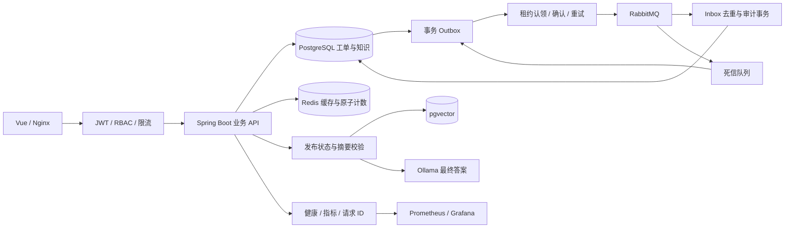

# 完整版运行与运维

本轮在原项目上扩展，保留原工单、权限、评论、历史和知识库流程。源码仍为 Java 21 / Spring Boot 4.1.1 / Vue 3，没有改成微服务。已有本机 PostgreSQL 数据库保留，完整模式默认使用原 Compose 的 5433 数据库。

## 启动选择

### 本机完整模式

前提：PowerShell 7.4+、Java 21、Node 22.12+、Docker Desktop（本机验证 Compose 5.5.1）。项目根目录已有 `.env` 时使用其中的原有 POSTGRES_PASSWORD，不要为已初始化的数据库随意换密码。

```powershell
Copy-Item .env.example .env # 仅首次，已有文件不要覆盖
# 编辑 .env 中的 POSTGRES_PASSWORD
.\scripts\start-enterprise.ps1 -WithAi
```

访问 http://127.0.0.1:5173。脚本使用 enterprise,ai 配置，启动 PostgreSQL、Redis、RabbitMQ 与本机 Java/Vue。首次需要编译；后续复用当前构建，源码变更时重新构建。日志在 backend-dev.log / frontend-dev.log，不创建额外可见终端。

AI 使用本机 Ollama：http://127.0.0.1:11434。模型：qwen3:4b、nomic-embed-text。模型需要事先准备；本机已经具备，本轮未重复下载。没有模型时去掉 -WithAi；AI 页面明确显示未启用，工单关键词推荐继续工作。

停止本机后台进程：`.\scripts\stop-enterprise.ps1`；加 `-StopInfrastructure` 同时停止本项目中间件容器，保留数据卷。脚本核对 PID 和项目进程路径，不按 Java/Node 进程名批量结束任务。可用 `-WhatIf` 查看操作范围。

enterprise 模式只作本地演示，包含 dev 初始化。演示账号：dev_zhangsan、dev_lisi、dev_wangwu（普通用户），dev_admin1（管理员）；密码均为 Demo@12345。

### 隔离的容器部署

```powershell
.\scripts\deploy-local.ps1 -Demo -WithAi -Monitoring -Build
```

发布 ZIP 已包含验证过的 JAR 和 dist，可使用 `-Prebuilt` 跳过容器内编译：` .\scripts\deploy-local.ps1 -Demo -WithAi -Monitoring -Prebuilt -Build`。此方式仍需要 Java/Nginx 运行时及基础服务镜像，但不再需要下载容器内 Maven/Node 编译环境。

使用独立的 smartticket-production Compose 项目、smartticket-prod-* 容器及新数据卷，保留原演示容器和本机数据库。前端入口 http://127.0.0.1:8088；Prometheus 为 9090；Grafana 为 3000。AI 模型服务通过 host.docker.internal:11434 访问，需要主机模型服务可达。

首次生成独立随机 PostgreSQL、Redis、RabbitMQ、JWT、监控、Grafana 和管理员密钥，保存在忽略目录 `.runtime/production.env`。正式管理员账号默认 admin，密码查阅该私有文件，不在文档中公开。不要把该文件提交到 Git。

- `-Demo` 明确加载 dev 演示账号和数据；真实使用时去掉此参数。
- `-WithAi` 加载 AI；去掉时 Redis、消息和业务仍可用。
- `-Monitoring` 启动 Prometheus 和 Grafana；运行监控页面与 Actuator 本身无需此参数。
- 首次或源码变化时使用 `-Build`。Dockerfile 内部构建，不依赖本机 Maven。

prod 模式不加载演示数据，首次在空库创建私有管理员。默认关闭公开注册，管理员在“用户与权限”页面创建账号；需要自助注册时设置 REGISTRATION_ENABLED=true。首次初始化后不会重置已有管理员密码。

生产形式部署提供非 root Java 进程、Nginx 静态资源和 API 代理、健康检查、优雅退出、私有中间件网络和持久化数据卷。默认只绑定本机入口，未执行公网发布；域名与 HTTPS 应由实际部署环境提供。

## 技术与业务的对应关系



| 能力 | 实际实现 | 验证入口 |
|---|---|---|
| Redis 缓存 | 权限范围独立的 Dashboard key、JSON 序列化、TTL、事务提交后缓存操作 | 工单统计、InfrastructureTests |
| 分布式限流 | Redis Lua 原子 INCR/PEXPIRE；普通 API、登录、AI 独立窗口 | RateLimitService、HTTP 429 / Retry-After |
| 登录保护 | 失败计数原子 TTL、成功清除；用户名 key 使用摘要 | LoginAttemptService |
| Token 撤销 | PostgreSQL 持久化摘要，Redis 只作加速，缓存丢失不恢复旧 Token | TokenBlacklistService |
| 会话失效 | 改密码、停用和角色调整递增 auth_version，每次 JWT 校验真实账号状态 | 账号安全、用户与权限 |
| 可靠消息 | 工单/历史/outbox 同一事务；行锁 SKIP LOCKED 认领、租约、confirm/return、退避重试 | OutboxService、运行监控 |
| 幂等消费 | processed_message 唯一键和审计同一事务，失败一起回滚 | TicketAuditListener |
| 死信恢复 | 先事务持久化回 outbox，再手动确认原死信；异常重新入队 | 运行监控“重放一条死信” |
| 可观测性 | Actuator、HTTP/JVM/事件指标、请求 ID、Prometheus、Grafana 配置 | /actuator、运行监控 |
| AI 问答 | Ollama、nomic embedding、pgvector、知识分块、来源校验、结构化最终答案 | 知识问答、AI 索引同步 |
| CI | PostgreSQL/Redis/RabbitMQ 服务、后端测试构建、前端锁文件构建 | .github/workflows/ci.yml |

不承诺未经测量的吞吐量、延迟或“绝不丢消息”。消息采用至少一次投递，数据库事务去重保证同一事件的业务审计不重复。缓存查询失败可回源数据库；分布式限流不可用时返回 503；写操作的缓存清理失败会报错，不静默宣称成功。创建请求仍建议携带 X-Request-Id，以安全重试。

## 数据和迁移

新增 event_outbox、processed_message、knowledge_vector_index；app_user 增加 enabled、auth_version。SQL 保持增量、幂等，同步保存于 sql/schema.sql 和后端 schema.sql。prod 和 dev 启动时执行安全结构脚本；没有 DROP，也不清空旧表。

AI 向量使用独立 smartticket_article_vectors 表（768 维），保留原 vector_store。只索引 PUBLISHED 文章，回答前再次检查数据库的发布状态和内容摘要。草稿、删除和更新后尚未同步的旧内容不会进入提示词；模型回答带可点击文章来源。同步按内容摘要跳过未变化文章，失败不伪装成功。

账号停用或管理员降级时，正在处理的指派自动释放并记录 ASSIGN 历史；不会把工单所有权转移给处理人。正式密码只保存 BCrypt，超过 BCrypt 字节上限会拒绝。改密后需要重新登录。

## 故障处理

1. 先看“运行监控”中 PostgreSQL、Redis、RabbitMQ 状态；轻量模式显示 DISABLED，并不伪装服务已启动。
2. PENDING 事件自动退避重试，最多 10 次后转为 FAILED。修复服务后点击“重试”。SENT 表示 Broker 确认，消费结果应结合审计查看。
3. 消费失败重试耗尽进入死信队列。修复原因后手动重放，重复重放仍由数据库 inbox 去重。
4. Redis 丢失只影响缓存/限流计数；撤销记录仍以 PostgreSQL 为准。限流依赖故障时不要绕过验证。
5. 模型或向量服务不可用时 AI 返回 503；业务工单与关键词推荐独立运行。AI 答案不能代替操作授权。
6. 请求失败时可从响应 X-Request-Id 关联后端日志。日志不记录密码、请求正文或完整 Token。

## 监控权限

健康探针允许匿名访问，只显示状态；其余 Actuator 默认要求管理员 JWT。容器 prod 启用独立的 Prometheus Basic 认证，monitor 账号仅能读取 /actuator/prometheus，不能访问业务接口。监控密码文件保存在 `.runtime/monitor-password`；Grafana 默认禁止自助注册。

prod 后端只在容器网络内访问，Nginx 覆盖转发来源头，后端据此识别访问 IP。不要把已信任转发头的 prod 后端直接暴露到不可信网络。

## 备份与恢复

```powershell
.\scripts\backup-db.ps1             # 完整模式原 Compose 数据库
.\scripts\backup-db.ps1 -Production # 独立 prod 数据库
```

生成 PostgreSQL 自定义格式归档，并执行 pg_restore --list 校验归档目录；这不等于完成全量恢复演练。备份位于 `.runtime/backups`，包含真实业务信息和密码哈希，不进入 Git 或发布 ZIP。

已提供并实际执行 ` .\scripts\verify-restore.ps1`：在无网络、无端口的独立临时容器中恢复新归档，核对五张核心表数量，并仅清理这次标记的临时容器。结果见 docs/restore-verification.json。业务原库不会被覆盖。

恢复时先准备一个新的空数据库，将备份复制进 PostgreSQL 容器，再执行 `pg_restore -U smartticket -d 新数据库 --exit-on-error 备份文件`。核验用户、工单、评论及历史数量后再切换配置；不要对当前业务库使用 --clean，不要删除原数据卷。

## 可重复验收

```powershell
mvn clean package '-Dinfra.tests=true'
cd frontend
npm ci
npm test
npm run build
cd ..
python scripts/api_smoke.py
python scripts/enterprise_smoke.py
node scripts/ui_smoke.cjs
```

中间件测试连接已有服务，默认不启用；`-Dinfra.tests=true` 明确打开。CI 也使用这一参数。浏览器验证需要 Playwright/Chromium，可用 PLAYWRIGHT_MODULE 指向已有安装目录。测试只清理自己创建的资源；死信测试在有非测试业务死信时跳过，不消费别人的待处理消息。

Redis 集成测试使用独立缓存前缀，真实验证缓存内容、TTL 与权限范围。

当前 Spring Data Redis 4.1 默认异步修改缓存。本项目显式配置 immediateWrites，并在事务提交后同步写入/清理，确保修改返回时变更已可见、清理错误可以传播。清理使用 SCAN 批次；集成测试连续 20 次验证写入与清理立即可见，不通过等待或重试掩盖时序错误。

验证证据：docs/enterprise-verification.json、docs/ai-verification.json、docs/api-verification.json、docs/ui-verification.json 与 docs/screenshots。CI 文件已提供，远程工作流运行状态以 GitHub 实际执行为准。

成品容器验证：`python scripts/deployment_smoke.py`。启用监控后使用 `python scripts/deployment_smoke.py --monitoring`，会真实查询 Prometheus 与 Grafana。此验收脚本使用显式 `-Demo` 的隔离部署账号，创建并清理自己的临时工单；正式无演示数据的站点不使用它。CI 在每次构建后部署完整 Docker 监控栈并执行该验收，验收 JSON 作为工作流产物保留。

发布包：运行 `python scripts/package_release.py` 生成 `artifacts/smart-ticket-system-complete.zip` 和 SHA-256 文件。包内包含源码、可执行 JAR、前端 dist、部署与验证脚本及逐文件校验清单，排除密码、备份、运行日志和个人文档。解压后可运行 `./scripts/deploy-local.ps1 -Demo -WithAi -Monitoring -Prebuilt -Build`；仍需要 Docker 及已准备好的本地 Ollama 模型，首次镜像下载时间取决于网络。

GitHub 发布可手动运行 Verify application 工作流，显式开启 publish_release 并填写已有草稿标签。只有完整构建、测试及监控部署验收通过后，才打包、校验并上传文件，再发布该草稿；默认普通 CI 不发布版本，也不会覆盖已正式发布的版本。
