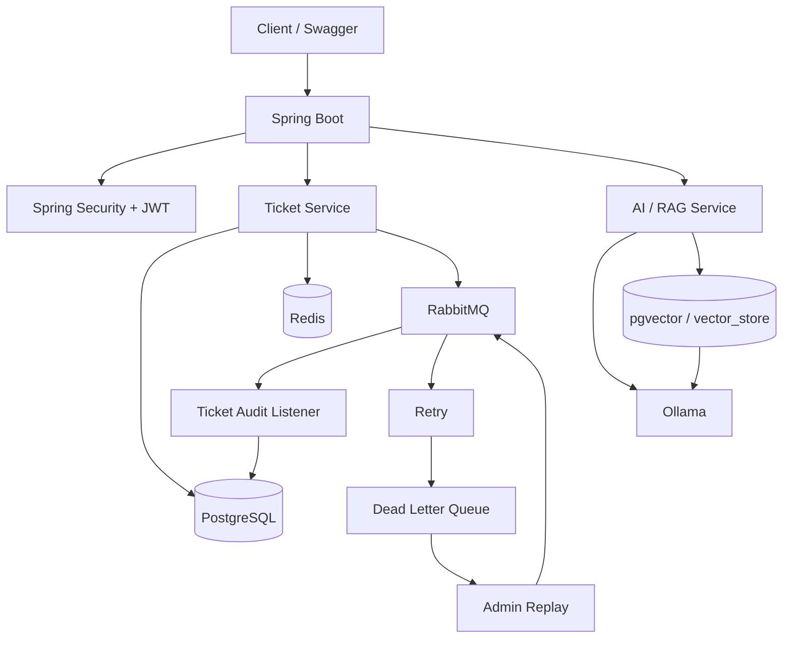

> 旧版扩展模块资料存档。Redis/RabbitMQ/Ollama/pgvector 代码保留，本次验证范围为 dev 核心演示模式；文中旧版能力描述不代表本次运行验证结论。

# Smart Ticket System

## 企业智能工单与知识协同平台

基于 **Spring Boot + PostgreSQL + Redis + RabbitMQ + Spring AI + Ollama** 构建的企业智能工单系统。

项目围绕企业内部 IT 服务与工单处理场景，实现用户认证、工单管理、权限控制、操作审计、Redis 缓存与幂等、RabbitMQ 异步处理与消息可靠性，以及基于 **pgvector + Ollama** 的 RAG 企业知识库和 AI 工单辅助能力。

项目采用 **模块化单体架构**，重点实践 Java 企业后端开发中常见的认证鉴权、缓存、消息队列、幂等控制、异常补偿、向量检索和容器化部署方案。

---

## 技术栈

### 后端

- Java 21
- Spring Boot 4.1
- Spring MVC
- Spring Security
- MyBatis-Plus
- Jakarta Validation
- JWT
- Maven

### 数据与缓存

- PostgreSQL 18
- pgvector 0.8.6
- Redis 7

### 消息队列

- RabbitMQ 4
- Spring AMQP

### AI / RAG

- Spring AI 2.0
- Ollama
- qwen3:4b
- nomic-embed-text
- PostgreSQL Vector Store
- RAG

### 工程化

- Swagger / OpenAPI
- Docker
- Docker Compose

---

## 系统架构



---

## 核心功能

### 用户认证与权限控制

基于 Spring Security + JWT 实现无状态认证。

支持：

- 用户注册
- 用户登录
- JWT Token 生成与校验
- USER / ADMIN 角色权限
- 普通用户工单数据隔离
- 管理员接口权限控制
- JWT 退出登录失效

普通用户只能访问自己的工单，管理员可以访问全局工单及管理功能。

---

### 工单管理

支持完整的工单 CRUD 与查询能力：

- 创建工单
- 查询工单
- 修改工单
- 删除工单
- 工单状态流转
- 分页查询
- 状态筛选
- 关键字搜索
- 用户数据隔离
- 工单统计

工单状态：

```text
OPEN
IN_PROGRESS
RESOLVED
CLOSED
```

优先级范围：

```text
1 - 5
```

---

## Redis 设计

Redis 在项目中并非只作为普通缓存使用，而是应用于多个实际业务场景。

### 工单统计缓存

工单统计 Dashboard 使用 Redis 缓存，减少重复数据库聚合查询。

示例：

```text
ticketStatistics::USER_2
ticketStatistics::ADMIN
```

缓存设置 TTL，并在以下操作发生时主动失效：

- 创建工单
- 修改工单
- 删除工单
- 修改工单状态

---

### JWT 黑名单

JWT 本身属于无状态 Token。

用户执行退出登录后，将 Token 写入 Redis 黑名单：

```text
jwt:blacklist:<token>
```

黑名单 TTL 与 Token 剩余有效期一致。

即使 Token 尚未自然过期，退出登录后也无法继续访问系统。

---

### AI 工单创建幂等

AI 创建真实工单时要求客户端携带：

```text
X-Request-Id
```

通过 Redis `SETNX` 思路实现请求幂等：

```text
idempotency:ticket:<userId>:<requestId>
```

避免网络重试或重复点击导致同一工单被多次创建。

---

### 登录失败限制

Redis 记录短时间内的登录失败次数：

```text
login:fail:<username>
```

连续登录失败达到阈值后，临时限制继续登录，用于降低暴力密码尝试风险。

---

### RabbitMQ 消费幂等

每个工单事件包含唯一：

```text
eventId
```

消费者处理消息前，通过 Redis 获取消息处理权：

```text
mq:processed:<eventId>
```

第一次消费：

```text
SETNX 成功
→ 正常执行业务
```

重复消息：

```text
SETNX 失败
→ 判定消息已经处理
→ 跳过重复业务操作
```

用于避免 RabbitMQ 重复投递造成操作日志重复写入。

---

## RabbitMQ 消息可靠性

创建工单后，系统发布工单创建事件：

```text
TicketController
      ↓
TicketEventPublisher
      ↓
RabbitMQ Exchange
      ↓
Audit Queue
      ↓
TicketAuditListener
      ↓
operation_log
```

将工单核心业务与审计日志处理进行异步解耦。

---

### 消息失败重试

消费者发生异常后，通过 Spring AMQP 配置自动重试。

支持：

- 最大重试次数
- 初始重试间隔
- 指数退避
- 最大重试间隔

---

### Dead Letter Queue

消息多次消费失败后，不直接丢弃，而是发送至 Dead Letter Exchange。

主交换机：

```text
smartticket.ticket.exchange
```

主队列：

```text
smartticket.ticket.audit.queue
```

死信交换机：

```text
smartticket.ticket.dlx
```

死信队列：

```text
smartticket.ticket.audit.dlq
```

处理流程：

```text
业务事件
   ↓
主队列
   ↓
消费异常
   ↓
自动重试
   ↓
重试耗尽
   ↓
Dead Letter Exchange
   ↓
Dead Letter Queue
```

---

### 管理员死信重放

系统提供管理员人工补偿接口：

```http
POST /admin/mq/replay-dead-letter
```

当异常原因修复后，管理员可以将 DLQ 中的消息重新发送到正常业务 Exchange。

```text
DLQ
 ↓
管理员 Replay
 ↓
主 Exchange
 ↓
主 Queue
 ↓
Listener
 ↓
业务重新处理
```

结合 Redis 消费幂等，避免消息重放过程中产生重复业务数据。

---

## 操作审计

系统使用：

```text
operation_log
```

记录关键业务行为。

目前包括：

```text
CREATE_TICKET_ASYNC
AI_CREATE_TICKET
UPDATE_TICKET
CHANGE_STATUS
DELETE_TICKET
```

记录内容包括：

- 操作用户
- 操作类型
- 目标资源
- 目标 ID
- 操作详情
- 操作时间

用于问题定位和业务审计。

---

## AI 工单能力

项目通过 Spring AI 接入本地 Ollama 模型。

Chat Model：

```text
qwen3:4b
```

Embedding Model：

```text
nomic-embed-text
```

目前实现：

- AI 基础对话
- 工单内容分析
- 工单优先级建议
- 工单处理建议
- AI 工单草稿生成
- AI 创建真实工单
- 企业知识库 RAG 问答

---

## RAG 企业知识库

项目使用：

```text
Spring AI
+
Ollama Embedding
+
PostgreSQL
+
pgvector
```

实现企业知识库检索增强生成。

基本流程：

```text
知识文档
   ↓
Embedding
   ↓
vector_store
   ↓
向量相似度检索
   ↓
Top-K 相关知识
   ↓
构造 Prompt
   ↓
LLM
   ↓
生成回答
```

知识向量存储于 PostgreSQL：

```text
vector_store
```

查询时通过向量相似度检索相关内容，再将检索结果提供给大语言模型生成答案。

---

## 数据库设计

主要业务表：

### app_user

存储用户与角色信息。

主要字段：

```text
id
username
password_hash
role
```

### ticket

存储工单。

主要字段：

```text
id
title
description
status
priority
user_id
created_at
updated_at
```

### operation_log

存储系统操作审计日志。

### vector_store

由 Spring AI 初始化，用于存储知识库向量数据。

---

## Docker Compose

项目使用 Docker Compose 管理基础设施。

当前包含：

```text
PostgreSQL 18 + pgvector
Redis 7
RabbitMQ 4 Management
```

启动：

```bash
docker compose up -d
```

查看状态：

```bash
docker compose ps
```

停止：

```bash
docker compose down
```

查看日志：

```bash
docker compose logs -f
```

正常启动后，三个服务应处于：

```text
healthy
```

状态。

---

## 项目结构

```text
smart-ticket-system/
│
├── backend/
│   ├── src/
│   │   └── main/
│   │       ├── java/
│   │       │   └── com.smartticket.backend/
│   │       │       ├── config/
│   │       │       ├── controller/
│   │       │       ├── dto/
│   │       │       ├── entity/
│   │       │       ├── exception/
│   │       │       ├── listener/
│   │       │       ├── mapper/
│   │       │       ├── security/
│   │       │       └── service/
│   │       │
│   │       └── resources/
│   │           └── application.properties
│   │
│   ├── pom.xml
│   ├── mvnw
│   └── mvnw.cmd
│
├── docker/
│   └── postgres/
│       └── init.sql
│
├── compose.yaml
├── .env.example
├── .gitignore
└── README.md
```

---

# 快速启动

## 1. 环境要求

需要安装：

- Java 21
- Docker Desktop
- Ollama
- Git

项目自带 Maven Wrapper，无需额外安装 Maven。

---

## 2. 配置环境变量

项目根目录提供：

```text
.env.example
```

复制为：

```text
.env
```

例如：

```env
POSTGRES_PASSWORD=your_postgres_password
```

`.env` 已加入 `.gitignore`，不要提交真实密码。

---

## 3. 启动基础设施

在项目根目录执行：

```bash
docker compose up -d
```

查看：

```bash
docker compose ps
```

默认端口：

| 服务 | 地址 / 端口 |
|---|---|
| PostgreSQL | localhost:5433 |
| Redis | localhost:6379 |
| RabbitMQ | localhost:5672 |
| RabbitMQ Management | http://localhost:15672 |

> RabbitMQ 当前 `guest/guest` 配置仅用于本地开发环境。

---

## 4. 启动 Ollama

安装模型：

```bash
ollama pull qwen3:4b
```

```bash
ollama pull nomic-embed-text
```

检查：

```bash
ollama list
```

确保两个模型已经存在。

---

## 5. Spring Boot 环境变量

后端需要配置：

```text
SPRING_DATASOURCE_URL
SPRING_DATASOURCE_USERNAME
SPRING_DATASOURCE_PASSWORD
JWT_SECRET
```

Docker 本地开发环境示例：

```text
SPRING_DATASOURCE_URL=jdbc:postgresql://localhost:5433/intelligent_ticket
SPRING_DATASOURCE_USERNAME=smartticket
SPRING_DATASOURCE_PASSWORD=<与 .env 中 POSTGRES_PASSWORD 一致>
JWT_SECRET=<your jwt secret>
```

建议不要将真实密码和 JWT Secret 直接提交到 Git 仓库。

---

## 6. 启动后端

进入：

```bash
cd backend
```

Windows：

```bash
mvnw.cmd spring-boot:run
```

Linux / macOS：

```bash
./mvnw spring-boot:run
```

也可以直接使用 IntelliJ IDEA 运行：

```text
com.smartticket.backend.BackendApplication
```

---

## 7. Swagger

后端默认运行：

```text
http://localhost:8080
```

Swagger UI：

```text
http://localhost:8080/swagger-ui/index.html
```

首先调用：

```http
POST /users/register
```

注册用户，然后：

```http
POST /users/login
```

获取 JWT。

在 Swagger 中点击：

```text
Authorize
```

填写 Token 后即可访问受保护接口。

---

## 常用接口

### 用户

```http
POST /users/register
POST /users/login
POST /users/logout
GET  /users/{id}
```

### 工单

```http
GET    /tickets
POST   /tickets
GET    /tickets/{id}
PUT    /tickets/{id}
DELETE /tickets/{id}

GET    /tickets/page
GET    /tickets/statistics
PATCH  /tickets/{id}/status
```

### AI

```http
POST /ai/chat
POST /ai/knowledge
POST /ai/rag
POST /ai/ticket-analysis
POST /ai/ticket-draft
POST /ai/ticket-create
```

### RabbitMQ 管理

```http
POST /admin/mq/replay-dead-letter
```

### 操作日志

管理员可以查询系统操作日志。

---

## 项目亮点

### Redis 多业务场景落地

Redis 实际用于：

```text
统计缓存
JWT 黑名单
接口幂等
登录失败限制
MQ 消费幂等
```

而非仅停留在简单 Key-Value 示例。

---

### RabbitMQ 消息可靠性设计

实现：

```text
异步解耦
+
失败自动重试
+
Dead Letter Queue
+
管理员人工补偿
+
Redis 消费幂等
```

形成较完整的异常消息处理链路。

---

### AI 与传统业务结合

AI 能力并非独立 Demo，而是与工单业务结合：

```text
用户描述问题
   ↓
AI 分析
   ↓
优先级建议
   ↓
工单草稿
   ↓
创建真实工单
```

同时通过 RAG 将企业知识库接入模型回答流程。

---

### 可复现开发环境

使用 Docker Compose 管理：

```text
PostgreSQL + pgvector
Redis
RabbitMQ
```

并通过：

```text
docker/postgres/init.sql
```

自动初始化数据库结构。

在新的开发环境中能够快速重新构建项目运行所需基础设施。

---

## 当前架构说明

当前项目采用：

```text
模块化单体架构
```

而非微服务架构。

选择单体架构主要是为了在当前业务规模下控制系统复杂度，同时完整实践：

```text
认证鉴权
数据库设计
Redis
消息队列
幂等
异常补偿
操作审计
Docker
AI
RAG
```

等企业后端常见能力。

---

## 后续规划

后续可继续扩展：

- 工单负责人 / 指派机制
- SLA 超时检测
- WebSocket 实时通知
- 工单附件
- Elasticsearch 全文检索
- 前端管理后台
- 自动化测试
- CI/CD
- Prometheus + Grafana 监控

---

## 项目状态

目前已经完成并实际验证：

- 用户注册 / 登录 / JWT 鉴权
- USER / ADMIN 权限控制
- 工单 CRUD
- 分页、搜索与统计
- 操作日志
- Redis 缓存
- JWT 黑名单
- 请求幂等
- 登录失败限制
- RabbitMQ 异步消费
- RabbitMQ 自动重试
- Dead Letter Queue
- 管理员死信重放
- Redis MQ 消费幂等
- Spring AI
- Ollama
- pgvector
- RAG 企业知识库
- AI 工单分析与创建
- Swagger
- Docker Compose
- PostgreSQL 初始化脚本
- 全新 Docker 数据库环境启动验证

---

## License

本项目主要用于学习、技术实践与求职作品展示。